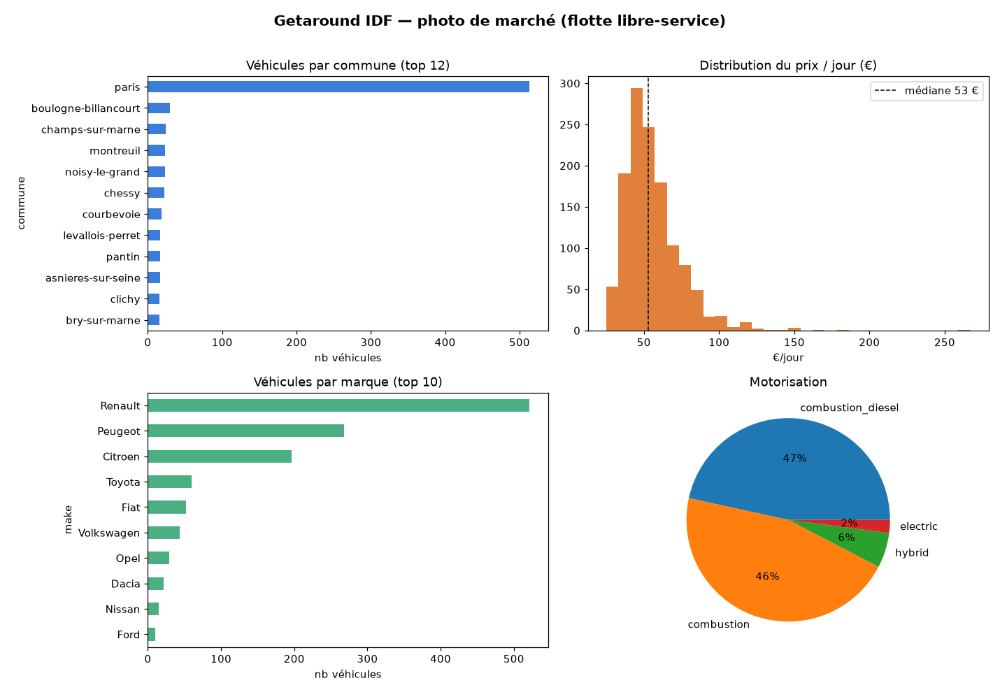

# Getaround IDF — rapport d'étude de marché

> _Régénéré le 2026-10-07 06:29 · état collecte : 🟢 à jour (dernier passage il y a 0.9 h)_

- **Passage analysé** : 2026-10-07 05:33:41
- **Passages collectés** : 7592
- **Flotte** : 1257 véhicules sur 110 communes
- **Prix/jour** : médiane 52 € (min 25 / max 267)

## Répartition géographique (top 10 communes)

| Commune | Véhicules |
|---|---|
| paris | 517 |
| boulogne-billancourt | 30 |
| champs-sur-marne | 24 |
| noisy-le-grand | 23 |
| montreuil | 22 |
| chessy | 22 |
| courbevoie | 18 |
| levallois-perret | 17 |
| pantin | 17 |
| clichy | 16 |

## Parc par marque (top 8)

| Marque | Véhicules |
|---|---|
| Renault | 522 |
| Peugeot | 266 |
| Citroen | 196 |
| Toyota | 61 |
| Fiat | 52 |
| Volkswagen | 43 |
| Opel | 30 |
| Dacia | 22 |

## Motorisation

| Type | Véhicules |
|---|---|
| combustion_diesel | 581 |
| combustion | 577 |
| hybrid | 73 |
| electric | 26 |

## Demande mesurée
- Occupation moyenne : 46.1%
- Véhicules avec ≥1 location détectée : 1253 / 2309
- Véhicules à prix variable (pricing dynamique) : 1115